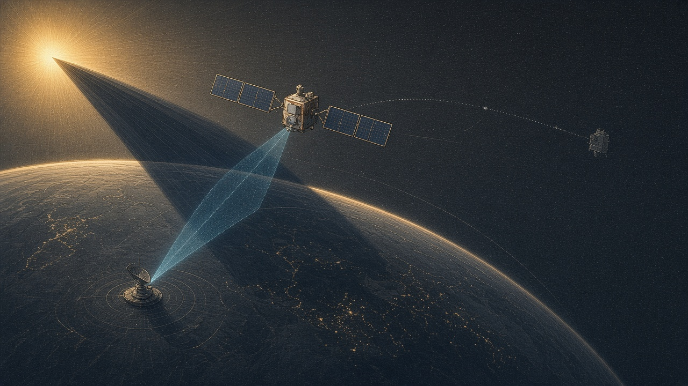

# space-env



Среда, в которой агент учится вести один аппарат на низкой орбите: держать батарею, снимать точки на Земле, говорить со станцией и решать, нужен ли манёвр при сближении. Из того же шага симуляции собираются тексты для языковой модели и траектории для обучения с подкреплением.

Это инженерная модель для обучения, не цифровой двойник конкретной миссии. Формулы названы в [плане реализации](docs/IMPLEMENTATION_PLAN.md): где кончается J2 и Клохесси–Уилтшир, там же написано.

## Четыре задачи

Среды зарегистрированы в Gymnasium. Первые четыре — аппарат около 420 км и наклонения 51.6°. Дальше идут карточки Sentinel-2 и Landsat 9.

| Среда | Что делает агент |
|-------|------------------|
| `space_env/ResourceManager-v0` | Выбирает нагрузку и доживает виток: тень сажает батарею, нагреватель включается у холода |
| `space_env/MissionPlanner-v0` | За сутки снимает точки на трассе, открывает сеанс и поднимает орбиту, если высота просела |
| `space_env/AnomalyResponse-v0` | По симптомам снимает перегруз шины, залипший нагреватель или защёлку радио |
| `space_env/ConjunctionAssessment-v0` | По промаху и вероятности решает, жечь ли метр в секунду вдоль трека или по нормали |
| `space_env/Constellation-v0` | Ведёт цепочку с шагом 1.5°: кадр копится в буфере, сеанс сливает его на станцию, ретрансляция отдаёт соседу, если луч не упирается в Землю |
| `space_env/ConstellationOps-v0` | Ведёт четыре аппарата: пакет по одному лучу за шаг доходит до аппарата над Фэрбанксом |
| `space_env/SentinelAcquisition-v0` | Снимает Sentinel-2A и сдаёт биты в окно Кируны, Шпицбергена или Матеры. Запись в память без сеанса очков не даёт |
| `space_env/LandsatAcquisition-v0` | То же для Landsat 9: регистратор 3.14 Тбит и сброс 384 Мбит/с |
| `space_env/SentinelPhasing-v0` | Держит пару Sentinel-2 на 180°: ошибка +0.5 м/с по скорости снимается одним встречным импульсом |
| `space_env/WorkPlan-v0` | Получает список дел на горизонт и выполняет его: снять названные цели и сдать память в выбранный сеанс |

Съёмка одного аппарата засчитывается один раз на цель и только вне полной тени. В группировке кадр — 8 Мбит за шаг при надире вне umbra. Сеанс связи открывается одной командой и длится до ухода за горизонт. Вероятность столкновения считается интегралом по диску твёрдого тела из промаха и ковариации. Дальности одной станции на короткой дуге дают радиус, сдвиг и скорость вдоль трека; поперек трека эта дуга ковариацию не сужает.

План одного аппарата на горизонт собирает `build_acquisition_plan`: время, цель или станция и причина, почему дело стоит в списке. Сеанс с низкой ступенью модема в список не входит, если более быстрое окно успевает забрать данные, пока они помещаются в память. Импульс в этот план добавляется отдельно. План цепочки собирает `build_relay_schedule`: 8 Мбит идут к аппарату с наибольшим углом места над Фэрбанксом, по одному лучу за шаг, и только если линия после шага Кауэлла открыта.

Тексты для языковой модели и траектории для обучения с подкреплением пишутся из этих же планов и сред:

```bash
python scripts/generate_sft_data.py -o datasets/sft.jsonl
python scripts/generate_rl_data.py -o datasets/rl_trajectories.jsonl
```

В SFT попадают карточка, план Sentinel-2A и план цепочки. В траектории — стадии из `configs/curriculum.yaml`, включая план одного аппарата и цепочку. По умолчанию шаги делает эвристика.

## Именованные аппараты

`space_env.catalog` собирает три открытые карточки. Рядом с каждой цифрой лежит источник. Чего в карточке нет, то записано как допущение и в расчёт «паспорта» не выдаётся.

| Ключ | Откуда орбита и борт | Что на этом учат |
|------|----------------------|------------------|
| `sentinel-2a`, `sentinel-2b` | 786 км, 98.62°, узел 10:30, 1140 кг, 2300 Вт, X-band 560 Мбит/с. TLE NORAD 40697 и 42063 | Съёмка полосой 290 км и сброс на Кируну, Шпицберген и Матеру |
| `landsat-9` | 705 км, 98.2°, 2623 кг, полоса 185 км, X-band 384 Мбит/с ряда LDCM. TLE 49260 | Тот же тип задачи на втором ряде и станциях Су-Фолс и Шпицберген |
| `iridium-next` | Звезда 86.4°:66/6/2, 780 км, 860 кг, кросс-линк 22.55–23.55 ГГц | Сосед в плоскости на ~4000 км, луч над лимбом. Запас Ka-линии не считается: ЭИИМ не опубликован |

Пара Sentinel-2 из карточки стоит через 180°. Снимок TLE — отдельное состояние на 20 октября 2026 и может от этой схемы отличаться. Свежие элементы Celestrak пишутся в другой каталог и этот снимок не затирают. В просмотрщике станция сеанса подсвечена, доля памяти берётся из кадра, а скачок маршрута рисуется отдельным цветом. Наклонения 98.62° и 98.2° дают узловую скорость J2 в пределах долей градуса от движения Солнца. У Iridium пакет идёт вперёд, назад и в соседние плоскости, пока хорда не задевает Землю, и может идти к слоту над Фэрбанксом или Темпе. Геометрический мидель Sentinel-2 и B* этого снимка считаются рядом: подгонка SGP4 мидель не подменяет. Граница сеанса уточняется до одной секунды. В окне снимка IERS звёздное время считается по UT1, и к повороту кадра добавляется полярное движение. На 20 октября 2026 каталог берёт наблюдаемый F10.7 = 121 и Ap = 8. Средний поток за 81 сутки до этой даты — 113.6 sfu, по скорректированному ряду Пенктитона.

```python
from space_env.catalog import make_engine, sentinel2_design_fleet, tle_orbit

engine = make_engine("sentinel-2a")          # средние элементы карточки и станции
live = tle_orbit("landsat-9")                # SGP4 на эпохе снимка, нужен extra sgp4
pair = sentinel2_design_fleet()
```

## Что внутри шага

- Орбита интегрируется методом Кауэлла: притяжение Земли, J2, сопротивление, солнечное давление и прилив Луны и Солнца.
- Тень — конус Земли. Тепловой узел видит Солнце, альбедо и инфракрасный поток Земли.
- Станция видна по углу места. Скорость сброса — ступени модема по запасу линии.
- Встреча с другим объектом интегрируется тем же Кауэллом. Ковариация из CDM с блоком скоростей переносится от момента сближения матрицей Клохесси–Уилтшира.

Атмосфера по умолчанию — таблица среднего Солнца и множитель F10.7; NRLMSISE-00 включается сценарием. Ориентация Земли — GMST плюс десять членов нутации IAU 1980. В окне снимка IERS к этому добавляются UT1 и полярное движение. Луна — укороченный ряд. Короткая дуга геометрических дальностей с одной станции оценивает радиус и движение вдоль трека; две станции и заданный шум дальности оценивают ещё и поперёк трека, и эта ковариация может заменить заданную σ в задаче сближения. Это модель для обучения на дуге часов и суток. Для операционного решения по реальному аппарату её мало: полный ряд IAU 2000A и фильтр сети слежения здесь не считаются.

## Картинка эпизода

В `viz/` лежит просмотрщик на three.js: Земля, тень, орбиты цепочки, станции, запас линии и открытые межспутниковые лучи. Кадры — тот же интегратор, что и обучение. Снять эпизод и открыть:

```bash
python scripts/export_viz.py -o viz/sample.json
python -m http.server -d viz 8765
```

Дальше в браузере `http://127.0.0.1:8765`. Формат файла пишет `space_env.viz.export_trajectory`: его можно вызвать из своего цикла и получить JSON для разбора или проигрывания.

## Быстрый старт

```bash
pip install -e ".[dev]"
pytest -q
```

Данные пишутся в `datasets/` (каталог в `.gitignore`):

```bash
python scripts/generate_pretraining_data.py -o datasets/pretraining.jsonl -n 100 -s 150
python scripts/generate_sft_data.py -o datasets/sft.jsonl
python scripts/generate_rl_data.py -o datasets/rl_trajectories.jsonl
python scripts/evaluate.py --episodes 2 --steps 12
python scripts/train_reinforce.py --env space_env/AnomalyResponse-v0 --episodes 40
```

Тексты для предобучения и SFT правятся в `data/`: глоссарий, шаблоны, пары вопрос–ответ. Веса наград — в `configs/rewards.yaml`, порядок сред — в `configs/curriculum.yaml`, пример аппарата — в `configs/scenarios/leo_nominal.yaml`.

## Репозиторий

```
space-env/
├── docs/            # эта картинка, план модели, обзор библиотек
├── src/space_env/   # физика, миссии, шаг, среды, генераторы, оценка
├── data/            # исходники текстов
├── configs/         # награды, куррикулум, сценарии
├── scripts/         # генерация, бенчмарк, короткое обучение
└── tests/
```

## Зависимости

В основе — `boinor`, `gymnasium`, `pydantic`, `numpy`, `pandas`, `pyyaml`.

По желанию: `sgp4` для старта с TLE, `spiceypy` если есть ядра SPICE, `ccsdspy` для разбора пакетов, `orekit-jpype` если стоят JDK и данные Orekit. Куда какая библиотека подключена — в [обзоре библиотек](docs/INDUSTRY_LIBRARIES.md).

## Лицензия

[Apache 2.0](LICENSE).
