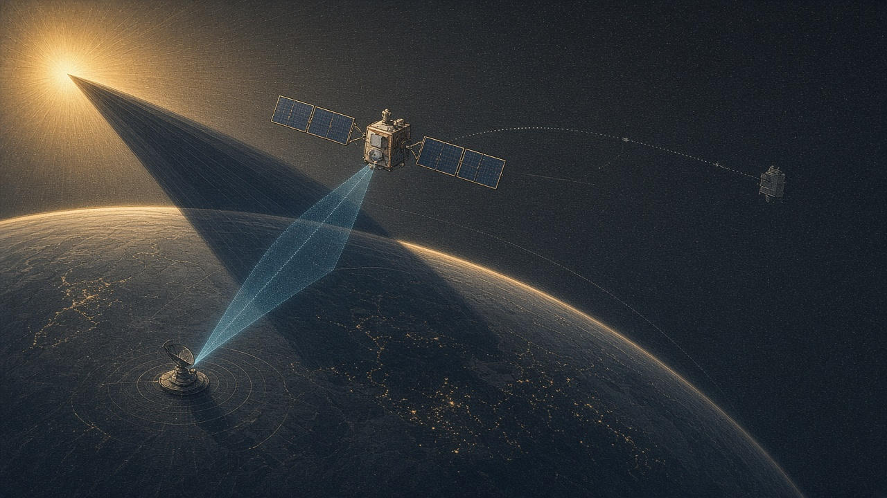

# space-env

[Конечная тяга и возмущения в навигации](docs/NAVIGATION_FINITE_FORCES.md):
matched-force EKF, номинальный расход массы, отмена и mid-burn replay.

[Управляемая навигация и питание сенсоров](docs/NAVIGATION_CONTROL_POWER.md):
known-impulse EKF, причинные delayed packets и общий native энергетический баланс.

[Sensor-aware задачи для агентов](docs/SENSOR_AWARE_TASKS.md):
EKF вместо истинной орбиты, ковариация, защищённая projection и native SFT/RL.

[Измерительная навигация M02-A](docs/NAVIGATION_MEASUREMENTS.md):
отдельный native passive sensor/EKF интерфейс, задержки и статистическая проверка.

[Требования к физическим моделям](docs/MODELING_REQUIREMENTS.md):
actor-level compatibility preflight, реестр моделей и явные unsupported cases.

[Аудит покрытия и план моделера M01–M10](docs/MODELING_COVERAGE_AND_ROADMAP.md):
что реализовано, где reduced models и какие доказательства ещё нужны.

[Относительное движение и групповой полёт](docs/RELATIVE_MISSION_GOALS.md):
native цели двух аппаратов, контрольные точки, sampled keepout, RTN-кинематика
и общие SFT/RL-критерии.

[Физические цели миссий и управление аппаратом](docs/PHYSICAL_MISSION_GOALS.md):
единый `TaskSpec.goal` для наведения, разгрузки маховиков, BODY-импульса,
заданного орбитального состояния, последовательных waypoint и доставки.
Kinematic/rigid attitude, химическая/электрическая и rotating off-center тяга
исполняются тем же native runtime; учитываются сроки, энергия, топливо и
заданные ограничения исправности. SDK, Gym/PettingZoo, LLM finish и SFT/RL
используют общий критерий успеха. Запуск: `python -m space_env.tasks.modeling_suite --output artifacts/new-modeling-suite`.
Это synthetic engineering profiles, не аппаратная или полётная квалификация.

[Пакет развития AI-среды и критерии завершения](docs/AI_ADVANCEMENT_BUNDLE.md):
[восстановление из фактического состояния](docs/SEQUENCE_RECOVERY.md),
[локальный SFT/evaluation workflow](docs/LLM_LEARNING_EXPERIMENT.md),
[аналитические физические эталоны](docs/AI_PHYSICS_REFERENCE.md),
[операционные задачи, включая разгрузку маховиков](docs/LLM_OPERATIONS_SUITE.md),
[измерение масштаба sequence-планировщика](docs/SEQUENCE_SCALE.md) и
[парное сравнение агентов](docs/PAIRED_AGENT_EVALUATION.md).
Реальное улучшение Qwen3.5 после SFT и превосходство над внешними симуляторами
пока не подтверждены; команды и ограничения приведены в соответствующих документах.

[Рабочий локальный Qwen-профиль и реальные train-данные](docs/JOINT_NETWORK_PLANNING.md#надёжный-llm-протокол-fixed-cadence-и-реальные-train-данные):
`python examples/llm/run_local_qwen.py --protocol-profile json_fixed_v1 --output /tmp/new-qwen-fixed`.
Модель выбирает действия; SDK обслуживает ревизии и объявленный физический такт.
Фактические model JSON targets экспортируются отдельно от служебных аргументов.


[LLM-агенты, SFT/RL данные и benchmark](docs/JOINT_NETWORK_PLANNING.md#llm-агенты-диалоги-sft-rl-и-benchmark):
нативные actor-only tool conversations, cold replay перед экспортом, assistant-only
SFT mask и episodic RL с rewards/discounts. Готовый пример: `python examples/llm/generate.py --output /tmp/new-llm-data`.
Фиксированный benchmark: `python -m space_env.llm.benchmark --output /tmp/new-llm-benchmark`.
Scripted demonstrations явно отделены от реальных LLM и внешних сравнений.


[Последовательности наземных сеансов](docs/JOINT_NETWORK_PLANNING.md#последовательности-наземных-сеансов-безопасное-сокращение-резервов):
`MissionWorkspace.network(configuration, planning_method="sequence_compact")`
сокращает Ground-резервы фиксированного плана по направлению предыдущего сеанса.
Для многотерминальных станций сохранён консервативный режим; глобальный оптимум
последовательностей не заявляется.


[Поиск и train-only селектор второго поколения](docs/JOINT_NETWORK_PLANNING.md#ограниченный-поиск-и-селектор-второго-поколения):
ограниченные кэши и безопасные отсечения exact-small; нормализация только по train,
диагностика loss/gradient/regret и отдельный фиксированный holdout. Локальное
сравнение старого и нового методов: `python -m space_env.planning.network_selector_study --output /tmp/selector-study-new`.


[Разнообразные заявки и оптимизационный эталон](docs/JOINT_NETWORK_PLANNING.md#разнообразные-заявки-и-глобальный-эталон-малых-задач):
отдельный frozen-набор с разными release/deadline, объёмами, CPU, памятью и
терминалами; `planning_method="exact_small"` выбирает цепочки глобально для
малой дискретной модели. Незакрытые границы не выдаются за оптимум. Прогноз
учитывает повторный захват спутника наземной антенной; результат подтверждает ACK.

[Обучаемый сетевой диспетчер и benchmark](docs/JOINT_NETWORK_PLANNING.md#обучаемый-диспетчер-и-разделённые-геометрические-группы):
12 фиксированных случаев, 6 геометрических групп, отдельные train/development/test.
Три правила сравниваются с train-only диспетчером, выбирающим одно из этих правил.
Все используют одинаковый прогноз и бюджет поиска, результат определяет native ACK.
Запуск: `python -m space_env.planning.network_benchmark --output /tmp/new-network-learning`.
Сохранённые модели можно подключать через SDK; это не command-level RL.

[Численные проверки и измерения сетевого профиля](docs/JOINT_NETWORK_PLANNING.md#численные-проверки-и-измерение-масштаба):
`python -m space_env.validation.network_evidence --output /tmp/new-network-evidence --external-forces`.
Отдельный линейный RF-расчёт, аналитические решения, внешний force cross-check
и измерения в свежих процессах. Ошибки и невыполненные заявки сохраняются;
проверка артефактов доступна через `--audit`. Это не подтверждение аппаратной
точности или превосходства над другими симуляторами.

[Совместное планирование EO → ISL → Ground](docs/JOINT_NETWORK_PLANNING.md):
`MissionWorkspace.network()` выбирает исполнителя, маршрут до трёх ISL-переходов,
станцию и время операций с общими ограничениями ресурсов. В пульте — кнопка
«EO / ISL / Ground». План исполняет native runtime; прогноз и фактический ACK
показаны отдельно. `evolve()` продолжает миссию из фактического владения продуктами после native-событий;
неполные ISL-фрагменты при отмене обрабатываются по правилам native-модели.



Среда, в которой агент учится управлять аппаратом или группировкой на низкой орбите: держать батарею, снимать точки на Земле, говорить со станцией и решать, нужен ли манёвр при сближении. Из того же шага симуляции собираются тексты для языковой модели и траектории для обучения с подкреплением.

Это инженерная модель для обучения, не цифровой двойник конкретной миссии. Крупные пакеты развития и критерии промышленной приемки — в [основном плане](docs/INDUSTRIAL_AI_SIMULATOR_PLAN.md); реализованные возможности и проверки — в [статусе пакета](docs/IMPLEMENTATION_STATUS.md).

**Настроить и выполнить свою миссию:** `python -m space_env.api.server`, затем
[localhost:8766](http://127.0.0.1:8766/). Орбиты, станции, заявки, горизонт,
план, фактическая доставка, карты и экспорт RL/SFT доступны на одной странице.
Тот же путь доступен через `space_env.workspace.MissionWorkspace` и
`python -m examples.workspace.run`. [Инструкция и ограничения](docs/MISSION_WORKSPACE.md).
Для автоматического выбора спутника и станции укажите «Автоматически» в форме
или `null` в конфигурации; явные назначения сохраняются.
[Перепланирование](docs/WORKSPACE_REPLANNING.md) создаёт независимое продолжение
на границе завершённых цепочек, проверяет физическое состояние и сохраняет
исходную сессию. Доступно в пульте, API и `MissionWorkspace.replan()`.
[Динамическое управление и группировка](docs/DYNAMIC_FLEET_PHYSICS.md): `evolve()`
применяет native-события и восстанавливает оставшиеся CPU/TX-этапы; `fleet_round()`
собирает решения аппаратов в один шаг, `relay()` запускает EO/CPU/ISL/Ground-ACK.
Контракты физических профилей и аналитические проверки отделены от аппаратной калибровки.
[Rolling-планировщик оператора](docs/ROLLING_OPERATOR_PLANNER.md) сохраняет историю
передач и временно откладывает неудачные направления; состояние проверяется
при восстановлении. Канал агента не может запрашивать операторский прогнозный план.
Планировщик сравнивает исходную эвристику с ограниченным поиском порядка заявок
и компактного резервирования ресурсов; прогноз не подменяет результат симуляции.

[Исполнимый план и сохраняемые RL/SFT bundles](docs/validation/MISSION_PLAN_BUNDLE_V1.md):
sealed fixed-input schedule, native goal certificate, fresh-process continuation,
retained episode и два режима аудита. Failed mission goal сохраняется в RL;
native verification не выдаётся за expert teacher qualification.

[Полные орбитальные циклы](docs/validation/FULL_ORBIT_MISSIONS_V1.md):
отдельный bounded multi-cycle compiler, периодические задачи без preload,
явные kinematic/rigid уровни ADCS и проверки доставки в разных release epochs.
Геометрический diagnostic отделён от доказательства выполнимости плана.

[Совместное управление колёсами и RCS](docs/validation/FIXED_CLOCK_ACTUATORS_V1.md):
held wheel/RCS commands, rotating chemical thrust, shared-tank bookkeeping,
fixed-input RK/partition checks и extended600s service regression.

[Контроллер с независимым тактом](docs/validation/FIXED_CONTROLLER_CLOCK_V1.md):
opt-in sample-and-hold motor commands, немедленные команды/защита и проверки
независимости от частоты событий. Прежняя event-driven модель сохранена отдельно.

[Исследование численного разрешения](docs/validation/MISSION_REFINEMENT_STUDY_V1.md):
условная self-refinement проверка, отдельная чувствительность к частоте контроллера
и событий, фиксированные unseen geometries и сохранение неудачных попыток.
Evaluator-only diagnostics не попадают в признаки агента или обучающие строки.

[Связанная многоспутниковая миссия](docs/validation/COUPLED_INDEPENDENT_MISSION_V1.md):
независимые плоскости, цели и станции; платное наведение, геометрическая съёмка,
обработка и доставка. Все запросы и отказы сохраняются. Синтетическая аппаратура
и metadata products; точность реального сенсора этим не заявляется.

[B09 масштабирование](docs/SCALING_CONTRACT.md): потоковые RL/SFT exports и дисковый
буфер фабрики, compact checkpoints с cold replay, изолированные workers и локальный
cross-bundle registry. [Профиль нагрузки](examples/scaling/README.md) измеряет
p50/p95 шага, peak RSS, стоимость fork/checkpoint/replay и verified export throughput.
Это проверяемые синтетические workloads, без заявления квалификации больших миссий.

[B10 Mission Control](docs/OPERATOR_CONTRACT.md) — пульт на общем native runtime:
команды и роли, текущая телеметрия, 3D/2D трассы, journal, checkpoint/replay и RL/SFT
на одной странице. Запуск: `python -m space_env.api.server`, затем
[localhost:8766/operator](http://127.0.0.1:8766/operator). Это локальный инженерный
режим; SQLite-сессии переживают рестарт, operator/agent передают управление через
revision/epoch. [Хранение и восстановление](docs/OPERATOR_DURABILITY_CONTRACT.md);
enterprise SSO и multi-tenant deployment пока не реализованы.

[B09-M export](docs/VERIFIED_EXPORT_CONTRACT.md): `VerifiedEpisode` проверяет
эпизод один раз и потоково экспортирует RL/SFT; `export_bundle()` публикует набор
файлов атомарно. История задач и idempotency-cache разделяют внутренние append-only
наблюдения, а публичные ответы и строки остаются независимыми копиями.

[B09-Q fleet workloads](examples/scaling/README.md#distinct-orbit-fleet-loads-b09-q)
задают разные орбиты в нескольких плоскостях и до 1000 индивидуальных задач.
Повторные запуски проверяют идентичность native результатов, лимиты задержки/RAM
и фиксируют CPU/quota/thread environment. Это synthetic fixed-ephemeris нагрузка.

[B08 factory](docs/FACTORY_CONTRACT.md) генерирует версионированные native-сценарии
из шаблонов и распределений, проверяет replay/балансы/ACK и собирает раздельные
train/holdout/OOD RL/SFT JSONL. Идентичные траектории между splits блокируют готовность
корпуса; ошибки и невыполнимые случаи остаются в аудите. [Пример](examples/factory/README.md):
`python examples/factory/demo.py /tmp/factory-corpus`. Генерация синтетическая;
статус `ready` означает прохождение заданных gates, а не экспертную квалификацию.

Добавлены [B07 baseline-планировщики](docs/PLANNING_CONTRACT.md): wait, random,
priority, EDF и ограниченный route-aware поиск текущих совместимых действий.
Один runner сохраняет состояние политики/RNG, действия оператора и проверяет cold
replay. Benchmark фиксирует manifest, lineage splits и пороги до запуска; успешное
исполнение не выдаётся за экспертность. [Пример без готовой последовательности команд](examples/planning/README.md):
`python examples/planning/demo.py /tmp/planning nominal`.

Для обучения на том же mission runtime доступен [единый task layer](docs/AGENT_RUNTIME_CONTRACT.md):
Gymnasium, опциональный PettingZoo (`.[marl]`), структурированные LLM tools,
разграничение ролей, причинные маски, физическое время/discount, холодный replay и
проверяемый RL/SFT JSONL. [Сквозной пример](examples/agent_task/README.md):
`python examples/agent_task/demo.py /tmp/task-demo nominal` — три спутника,
съёмка → onboard CPU → ISL custody → ground ACK. Каталог действий конечный;
телеметрия идеальная локальная, а scripted teacher не считается экспертной политикой.

В coupled spacecraft profile доступна [тяга в системе корпуса](docs/validation/BODY_THRUST_CONTRACT.md): chemical/electric engine, конечный gimbal, подготовка, расход топлива и связанные энергия/тепло. Пример: `python examples/actuation/demo.py /tmp/body-thrust chemical`. Доступен opt-in [режим вращения с маховиками](docs/validation/RIGID_MISSION_CONTRACT.md): `python examples/rigid_mission/demo.py /tmp/rigid-mission tuned`. В нём отмена не обнуляет spin; для вращающейся/off-center тяги нужен явный `engine.rigid_coupling` с ограничением потери массы при постоянной инерции. [Контракт](docs/validation/ROTATING_THRUST_CONTRACT.md), пример: `python examples/rotating_thrust/demo.py /tmp/rotating chemical`.

Для разгрузки маховиков доступен [ресурсный RCS-профиль](docs/validation/MOMENTUM_UNLOADING_CONTRACT.md): `python examples/momentum_unloading/demo.py /tmp/unloading nominal`. Он расходует газ и электроэнергию, а при нехватке времени сохраняет остаточный момент и сообщает failed.

Доступна [многозонная тепловая модель](docs/validation/THERMAL_NETWORK_CONTRACT.md): проводимость, излучение, отдельный нагрев компонентов, платные нагреватели и блокировки по температуре. Пример: `python examples/thermal_network/demo.py /tmp/thermal nominal` (также `hot` и `cold`).

Короткая миссия группировки запускается так:

```bash
python -m space_env.cli validate configs/scenarios/mission_short.yaml
python -m space_env.cli run configs/scenarios/mission_short.yaml --policy priority --step 60
python -m space_env.cli benchmark mission_v1_smoke.yaml
```

`benchmark` проверяет обычную сдачу, закрытую станцию, ранний срок и все 12 заявок короткой миссии. 72 часа в этот набор не входят.

Доступен связанный профиль борта `reference-spacecraft-bus/1`: конечные развороты,
settling/pointing, body-fixed панели, батарейные потери, нагрев и safe/fault/recovery.
[Контракт и ограничения](docs/validation/SPACECRAFT_PROFILES.md),
[пример миссии с checkpoint посреди разворота](examples/spacecraft_bus/demo.py).
Площадные заявки поддерживают rectangular footprints, WGS84 polygon/AOI
coverage, union без двойного зачета и проверку площади после доставки.
[Контракт и optional coverage extra](docs/validation/AREA_COVERAGE_CONTRACT.md),
[сквозной пример](examples/area_coverage/demo.py).
Добавлены явные optical/SAR модели: пространственные маски облаков и unknown,
освещённость/GSD, SAR incidence/side/resolution и ограничения мощности/duty.
[Контракт и пределы точности](docs/validation/PAYLOAD_QUALITY_CONTRACT.md),
[два примера с qualified delivery](examples/payload_quality/demo.py).
Revisit/stereo-заявки используют времена съёмки, разные acquisitions и общую
пригодную площадь. Группировка может доставлять явно названные части ground bundle:
[контракт](docs/validation/OBSERVATION_REQUIREMENTS.md),
[два сквозных примера](examples/observations/demo.py).
Опциональный `resource-lanes/1` допускает одновременные CPU, съёмку и downlink
с общими ограничениями мощности, памяти и bandwidth:
[контракт](docs/validation/RESOURCE_LANES_CONTRACT.md),
[миссия без preloaded data](examples/resource_lanes/demo.py). Serial режим сохранён.
Это проверенные synthetic surrogates; научная radiometry/SAR focusing,
continuous swath и динамика исполнительных органов остаются в плане B04.

## Общий runtime миссий

Scenario v3 объединяет явные legacy/reference adapters, команды с revision и
idempotency, раздельные agent/truth views и проверяемые checkpoint/resume/replay.
[Контракт и команды CLI](docs/architecture/RUNTIME_V1.md),
[исполняемый пример](examples/unified_runtime/demo.py).
Доступен также `reference-dynamic-downlink/1`: импульсные и конечные включения,
масса/топливо, пересчет окон связи и восстановление посреди включения.
[Динамический пример](examples/unified_runtime/dynamic_demo.py),
[матрица точности и незакрытая квалификация B02](docs/validation/PHYSICS_QUALIFICATION_MATRIX.md).
Фиксированный reference и legacy остаются отдельными явными профилями.
Опционально доступны Cartesian STM/covariance prediction, acceleration process noise
и uncertainty импульса: [контракт](docs/validation/NAVIGATION_COVARIANCE_CONTRACT.md),
[пример](examples/unified_runtime/navigation_demo.py). Это прогноз неопределенности,
а не навигационный фильтр или автоматически стохастическое исполнение команд.
Добавлены readonly окна точечной съёмки и затмений с ограничениями сенсора,
а также привязка команд к актуальному прогнозу: [контракт](docs/validation/GEOMETRY_EVENTS_CONTRACT.md),
[пример](examples/unified_runtime/geometry_demo.py). Фактическая съёмка и создание
продуктов теперь поддержаны отдельным `reference-lifecycle/1`: request → acquisition
→ raw → transform DAG → delivery. [Контракт](docs/validation/PRODUCT_LIFECYCLE_CONTRACT.md),
[пример без preloaded data](examples/end_to_end_eo/demo.py). Профиль моделирует ресурсы,
синтетические метаданные и JSON geometry features; это не генератор реальных изображений.

## Переносимый эксперимент

Прямые команды группировки можно записать вместе с конфигурацией, состоянием и журналом, проверить повтором и экспортировать в JSONL:

```bash
python -m space_env.cli record-commands examples/portable_run/mission.yaml examples/portable_run/plan.json /tmp/space-run.json --lineage portable-demo-1
python -m space_env.cli replay-run /tmp/space-run.json
python -m space_env.cli export-transitions /tmp/space-run.json /tmp/transitions.jsonl
```

Исходный YAML после записи не нужен. Экспорт содержит проверенные поведенческие переходы; replay не доказывает качество эксперта. Форматы, SDK и ограничения — в [руководстве](docs/PORTABLE_EXPERIMENTS.md).

Записываемые вызовы агента, прогноз геометрии, baseline и последовательная
ретрансляция с экспортом tool-dialogue описаны в [руководстве протокола](docs/AGENT_PROTOCOL.md).
Рабочий пример передачи5 Мбит: `python examples/agent_tools/relay_demo.py /tmp/agent-demo`.

Отдельное физическое ядро GCRS с явным временем/EOP и адаптивной пропагацией:
`python -m space_env.cli physics-reference --long`.
[Применимость и SDK](docs/validation/GCRS_REFERENCE_V1.md). Основные среды пока работают
на явно обозначенном legacy-профиле; reference orbit не подменяет их физику автоматически.

Окна наземной связи, дальность/range-rate и внешняя сверка формул сил:
[Reference access](docs/validation/REFERENCE_ACCESS_V1.md).
`python -m space_env.cli physics-reference --long --crosscheck` сравнивает J2/drag/
third-body формулы с Boinor, а J2 дуги — с LSODA при объявленных общих inputs.

Исполнение передачи данных и обучение на фиксированных GCRS-траекториях:
[Reference downlink operations](docs/validation/REFERENCE_OPERATIONS_V1.md).

Generate an executable, simulator-verified multi-satellite downlink baseline with
`space-env reference-plan spec.json plan.json --report schedule.json`.
See [scheduling contract and limitations](docs/validation/REFERENCE_SCHEDULING_V1.md).
Use `reference-replan` and `reference-resume` to continue a verified partial run;
[product selection and rolling planning](docs/validation/REFERENCE_REPLANNING_V2.md)
also cover the optional expanded Gym action space.

[Dynamic reference operations](docs/validation/REFERENCE_DYNAMIC_OPERATIONS_V3.md)
add audited data arrivals, priority changes and station faults/recovery, one-command
`reference-adapt`, and fixed-capacity RL episodes with events during execution.
Run `python examples/reference_operations/dynamic_demo.py /tmp/space-env-dynamic-demo`.

[Service lifecycle v4](docs/validation/REFERENCE_SERVICE_LIFECYCLE_V4.md) adds
cancellation/discard accounting, deadline changes, degraded transmitter/station
throughput and matching planner/RL/replay behavior. Runnable scenario:
`python examples/reference_operations/lifecycle_demo.py /tmp/space-env-lifecycle`.

[Ground booking v5](docs/validation/REFERENCE_GROUND_BOOKING_V5.md) adds conflict-checked
terminal reservations, single-radio booking limits, exclusive service policies,
cancellation, service-window diagnostics and reservation utilization.
Run `python examples/reference_operations/booking_demo.py /tmp/space-env-bookings`.

[Transmitter health v6](docs/validation/REFERENCE_TRANSMITTER_HEALTH_V6.md) adds
opt-in one-node thermal trip/cooling and cumulative TX quotas, resource-aware
station handover, heat accounting and matching Gym/replay telemetry.
Run `python examples/reference_operations/thermal_demo.py /tmp/space-env-thermal`.

[Onboard processing v7](docs/validation/REFERENCE_ONBOARD_PROCESSING_V7.md) adds
in-place processing queues, CPU energy/scratch memory, pause/preemption, raw-data
downlink gating and matching planner/Gym/replay controls.
Run `python examples/reference_operations/processing_demo.py /tmp/space-env-processing`.

[Processing dependencies v8](docs/validation/REFERENCE_PROCESSING_DEPENDENCIES_V8.md)
adds validated same-actor prerequisites, cycle rejection, retained input inventory,
dynamic graph admission and graph telemetry for agents.
Run `python examples/reference_operations/dependency_demo.py /tmp/space-env-dependencies`.

[Calendar qualification v9](docs/validation/REFERENCE_CALENDAR_QUALIFICATION_V9.md)
adds a bounded exact subset-DP oracle, fair matching-class regret and portable
benchmark recomputation with declared train/test lineage checks.
Run `python examples/reference_operations/optimal_demo.py /tmp/space-env-calendar`.

[Explicit CPU dispatch v10](docs/validation/REFERENCE_CPU_DISPATCH_V10.md) adds
per-step job selection, admission diagnostics and optional Dict radio/CPU Gym
actions, with CLI recording and replay.
Run `python examples/reference_operations/cpu_selection_demo.py /tmp/space-env-cpu-choice`.
Пример с двумя аппаратами, общим терминалом и outage:
`python examples/reference_operations/demo.py /tmp/reference-downlink`.

## Четыре задачи

Среды зарегистрированы в Gymnasium. Первые четыре — аппарат около 420 км и наклонения 51.6°. Дальше идут карточки Sentinel-2 и Landsat 9.

| Среда | Что делает агент |
|-------|------------------|
| `space_env/ResourceManager-v0` | Выбирает нагрузку и доживает виток: тень сажает батарею, нагреватель включается у холода |
| `space_env/MissionPlanner-v0` | За сутки снимает точки на трассе, открывает сеанс и поднимает орбиту, если высота просела |
| `space_env/AnomalyResponse-v0` | По симптомам снимает перегруз шины, залипший нагреватель или защёлку радио |
| `space_env/ConjunctionAssessment-v0` | По промаху и вероятности решает, жечь ли метр в секунду вдоль трека или по нормали |
| `space_env/Constellation-v0` | Ведёт цепочку с шагом 1.5°: кадр копится в буфере, сеанс сливает его на станцию, ретрансляция отдаёт соседу, если луч не упирается в Землю |
| `space_env/ConstellationOps-v0` | Ведёт четыре аппарата: пакет по одному лучу за шаг доходит до аппарата над Фэрбанксом |
| `space_env/SentinelAcquisition-v0` | Снимает Sentinel-2A и сдаёт биты в окно Кируны, Шпицбергена или Матеры. Запись в память без сеанса очков не даёт |
| `space_env/LandsatAcquisition-v0` | То же для Landsat 9: регистратор 3.14 Тбит и сброс 384 Мбит/с |
| `space_env/SentinelPhasing-v0` | Держит пару Sentinel-2 на 180°: ошибка +0.5 м/с по скорости снимается одним встречным импульсом |
| `space_env/WorkPlan-v0` | Получает список дел на горизонт и выполняет его: снять названные цели и сдать память в выбранный сеанс |

Съёмка одного аппарата засчитывается один раз на цель и только вне полной тени. В группировке кадр — 8 Мбит за шаг при надире вне umbra. Сеанс связи открывается одной командой и длится до ухода за горизонт. Вероятность столкновения считается интегралом по диску твёрдого тела из промаха и ковариации. Дальности одной станции на короткой дуге дают радиус, сдвиг и скорость вдоль трека; поперек трека эта дуга ковариацию не сужает.

План одного аппарата на горизонт собирает `build_acquisition_plan`: время, цель или станция и причина, почему дело стоит в списке. Сеанс с низкой ступенью модема в список не входит, если более быстрое окно успевает забрать данные, пока они помещаются в память. Импульс в этот план добавляется отдельно. План цепочки собирает `build_relay_schedule`: 8 Мбит идут к аппарату с наибольшим углом места над Фэрбанксом, по одному лучу за шаг, и только если линия после шага Кауэлла открыта. Очередь сближений, второй импульс фазы, подъём перигея и обход закрытого луча собирают функции из `space_env.mission.horizon`. Импульс очереди исполняется: через 1200 с горячая пара ниже 10⁻⁴, без импульса она остаётся выше. Подъём перигея на 400 км заканчивается большей полуосью, чем прогон без манёвра. Эти два решения — среды `ConjunctionQueue-v0` и `DecayWatch-v0`, они входят в куррикулум и в SFT.

Тексты для языковой модели и траектории для обучения с подкреплением пишутся из этих же планов и сред:

```bash
python scripts/generate_sft_data.py -o datasets/sft.jsonl
python scripts/generate_rl_data.py -o datasets/rl_trajectories.jsonl
```

В SFT попадают карточка, план Sentinel-2A и план цепочки. В траектории — стадии из `configs/curriculum.yaml`, включая план одного аппарата и цепочку. По умолчанию шаги делает эвристика. Случайный бенчмарк обходит все зарегистрированные среды, у каждой свой потолок шагов. Перед `gym.make` нужен `import space_env`. Карточки наблюдений лежат в `space_env.ENV_CARDS`. Цепочку с действием из двух чисел учит `train_multidiscrete_reinforce`. Второй импульс фазы и обход закрытого луча — среды `PhaseBurn-v0` и `Reroute-v0`. Смена `FleetShift-v0` доводит пакет до шлюза и не жжёт импульс на пару ниже 10⁻⁴. Дальше в реестре удержание дистанции, выбор приоритетной цели на опорном 6U, отказ радио в окне, уклонение от неманеврирующего фрагмента и увод с 780 км. Бенчмарк `run_benchmark_tracks` считает пять дорожек на сиде обучения и на отложенном сиде. Одна политика сдачи проверяется на Sentinel-2A, Landsat 9 и 6U. Спор за станцию, пакет заявок и защёлка радио в сеансе Sentinel — отдельные среды. `scale_report` проверяет спор за станцию, заявки и смену при росте числа аппаратов. `build_day_campaign` собирает сутки Sentinel-2A, Landsat 9 и 6U: заявка на виток, все найденные сеансы и один бюджет Δv. Сближения горячей и тёплой пар выходят из Δa и Δν на эпоху. Час встречи в таблицу не записан, его находит пропагация. `RadarPass-v0` снимает кадр в тени. `LongitudeKeep-v0` возвращает геосинхронную большую полуось. Импульс 1 м/с по скорости ставится в начале дуги и прогоняется тем же Кауэллом: горячая и тёплая пары после него ниже 10⁻⁴, и план съёмки этого аппарата строится уже с импульсом. Свои орбиты Sentinel-2B, Landsat 9, 6U и фрагмента в очередь не попадают: их Pc ниже порога. Сеть зеркал разбирает физические окна Шпицбергена до сборки дел: пересечение остаётся у аппарата с большим буфером, второй сеанс собирается на свободной станции. `DishAward-v0` отдаёт каждое такое окно по порядку. Малый радар на 550 км и 97.4° с аномалии 180° тоже закрывает Шпицберген и входит в спор. `OperatorShift-v0` — одна настраиваемая смена: состав аппаратов, горизонт и бюджет задаются при запуске, оператор сначала отдаёт зеркало, затем исполняет эти окна. Режим `until=award` учит только раздачу окон и платит за каждый верный шаг. Сутки лежат в `configs/scenarios/operator_shift.yaml`. На исполнении видны окно импульса, линия и цель; недопустимая команда отвергается отдельно от награды. Смена исполняет уже разданные окна. 6U сдаёт на Москву. Горизонт в трое суток оставляет тот же бюджет. Это среда `DayMission-v0`. `DayShift-v0` ведёт Sentinel-2A, Landsat 9, малый радар и 6U шагом каждого движка: кадр, сдача и списание Δv. `training_report` сравнивает хвост обучения со случайной политикой и с эвристикой.

## Именованные аппараты

`space_env.catalog` собирает три открытые карточки. Рядом с каждой цифрой лежит источник. Чего в карточке нет, то записано как допущение и в расчёт «паспорта» не выдаётся.

| Ключ | Откуда орбита и борт | Что на этом учат |
|------|----------------------|------------------|
| `sentinel-2a`, `sentinel-2b` | 786 км, 98.62°, узел 10:30, 1140 кг, 2300 Вт, X-band 560 Мбит/с. TLE NORAD 40697 и 42063 | Съёмка полосой 290 км и сброс на Кируну, Шпицберген и Матеру |
| `landsat-9` | 705 км, 98.2°, 2623 кг, полоса 185 км, X-band 384 Мбит/с ряда LDCM. TLE 49260 | Тот же тип задачи на втором ряде и станциях Су-Фолс и Шпицберген |
| `iridium-next` | Звезда 86.4°:66/6/2, 780 км, 860 кг, кросс-линк 22.55–23.55 ГГц | Сосед в плоскости на ~4000 км, луч над лимбом. Запас Ka-линии не считается: ЭИИМ не опубликован |

Пара Sentinel-2 из карточки стоит через 180°. Снимок TLE — отдельное состояние на 20 октября 2026 и может от этой схемы отличаться. Свежие элементы Celestrak пишутся в другой каталог и этот снимок не затирают. В просмотрщике станция сеанса подсвечена, доля памяти берётся из кадра, а скачок маршрута рисуется отдельным цветом. Наклонения 98.62° и 98.2° дают узловую скорость J2 в пределах долей градуса от движения Солнца. У Iridium пакет идёт вперёд, назад и в соседние плоскости, пока хорда не задевает Землю, и может идти к слоту над Фэрбанксом или Темпе. Геометрический мидель Sentinel-2 и B* этого снимка считаются рядом: подгонка SGP4 мидель не подменяет. Граница сеанса уточняется до одной секунды. В окне снимка IERS звёздное время считается по UT1, и к повороту кадра добавляется полярное движение. На 20 октября 2026 каталог берёт наблюдаемый F10.7 = 121 и Ap = 8. Средний поток за 81 сутки до этой даты — 113.6 sfu, по скорректированному ряду Пенктитона.

```python
from space_env.catalog import make_engine, sentinel2_design_fleet, tle_orbit

engine = make_engine("sentinel-2a")          # средние элементы карточки и станции
live = tle_orbit("landsat-9")                # SGP4 на эпохе снимка, нужен extra sgp4
pair = sentinel2_design_fleet()
```

## Что внутри шага

- Орбита интегрируется методом Кауэлла: притяжение Земли, J2, сопротивление, солнечное давление и прилив Луны и Солнца.
- Тень — конус Земли. Тепловой узел видит Солнце, альбедо и инфракрасный поток Земли.
- Станция видна по углу места. Скорость сброса — ступени модема по запасу линии.
- Встреча с другим объектом интегрируется тем же Кауэллом. Ковариация из CDM с блоком скоростей переносится от момента сближения матрицей Клохесси–Уилтшира.

Атмосфера по умолчанию — таблица среднего Солнца и множитель F10.7; NRLMSISE-00 включается сценарием. Ориентация Земли — GMST плюс десять членов нутации IAU 1980. В окне снимка IERS к этому добавляются UT1 и полярное движение. Луна — укороченный ряд. Короткая дуга геометрических дальностей с одной станции оценивает радиус и движение вдоль трека; две станции и заданный шум дальности оценивают ещё и поперёк трека, и эта ковариация может заменить заданную σ в задаче сближения. Это модель для обучения на дуге часов и суток. Для операционного решения по реальному аппарату её мало: полный ряд IAU 2000A и фильтр сети слежения здесь не считаются.

## Картинка эпизода

В `viz/` лежит просмотрщик на three.js: Земля, тень, орбиты цепочки, станции, запас линии и открытые межспутниковые лучи. Кадры — тот же интегратор, что и обучение. Снять эпизод и открыть:

```bash
python scripts/export_viz.py -o viz/sample.json
python -m space_env.api.server
```

Студия открывается на `http://127.0.0.1:8766/studio`: по умолчанию сутки аппаратов сценария, журнал дел плана и трассы, рядом учебная цепочка и звезда 66/6/2. Пульт внизу страницы открывает живую смену `OperatorShift-v0`: человек отдаёт зеркало, затем съёмку, сдачу и импульс. Звезда 66/6/2 на 780 км считается тем же Walker-star; линия 1 Вт на соседних 4000 км не замыкается. Проигрыватель орбит по-прежнему:

```bash
python -m http.server -d viz 8765
```

Дальше в браузере `http://127.0.0.1:8765`. Формат файла пишет `space_env.viz.export_trajectory`: его можно вызвать из своего цикла и получить JSON для разбора или проигрывания.

## Быстрый старт

```bash
pip install -e ".[dev]"
pytest -q
```

Данные пишутся в `datasets/` (каталог в `.gitignore`):

```bash
python scripts/generate_pretraining_data.py -o datasets/pretraining.jsonl -n 100 -s 150
python scripts/generate_sft_data.py -o datasets/sft.jsonl
python scripts/generate_rl_data.py -o datasets/rl_trajectories.jsonl
python scripts/evaluate.py --episodes 2 --steps 12
python scripts/train_reinforce.py --env space_env/AnomalyResponse-v0 --episodes 40
```

Тексты для предобучения и SFT правятся в `data/`: глоссарий, шаблоны, пары вопрос–ответ. Веса наград — в `configs/rewards.yaml`, порядок сред — в `configs/curriculum.yaml`, пример аппарата — в `configs/scenarios/leo_nominal.yaml`.

## Репозиторий

```
space-env/
├── docs/            # эта картинка, план модели, обзор библиотек
├── src/space_env/   # физика, миссии, шаг, среды, генераторы, оценка
├── data/            # исходники текстов
├── configs/         # награды, куррикулум, сценарии
├── scripts/         # генерация, бенчмарк, короткое обучение
└── tests/
```

## Зависимости

В основе — `boinor`, `gymnasium`, `pydantic`, `numpy`, `pandas`, `pyyaml`.

По желанию: `sgp4` для старта с TLE, `spiceypy` если есть ядра SPICE, `ccsdspy` для разбора пакетов, `orekit-jpype` если стоят JDK и данные Orekit. Куда какая библиотека подключена — в [обзоре библиотек](docs/INDUSTRY_LIBRARIES.md).

## Лицензия

[Apache 2.0](LICENSE).

### Sampled RF and ground service (B05-A)

Opt-in `operations.radio_network` connects declared Friis/EIRP/G/T/Eb/N0 modem
budgets, antenna acquisition/handover, station capacity pools, versioned booking
imports and delayed ideal ACK to actual battery/thermal/lifecycle execution.
Run `python examples/network_mission/demo.py /tmp/network nominal` (also `outage`,
`blocked`). See [contract and limits](docs/validation/RADIO_GROUND_CONTRACT.md).
Concurrent reference-runtime ISL/custody is implemented in B05-B below; calibrated
weather remains open.

### Concurrent ISL and custody transport (B05-B)

Opt-in `operations.dtn_network` and runtime `relay` commands add shared half-duplex
TX/RX admission, reserved receiver buffers, packet propagation, loss/retry/dedup,
immutable lifetime and atomic whole-product custody. Acquisition provenance is
preserved; customer credit still waits for final ground ACK.
Run `python examples/relay_mission/demo.py /tmp/relay nominal` (also `reroute`,
`loss`, `ttl`). See [quickstart](examples/relay_mission/README.md) and
[engineering contract/limits](docs/validation/CUSTODY_NETWORK_CONTRACT.md).
This is an isolated-link store-and-forward model, not BPv7/BIBE/LTP or calibrated
RF/flight hardware.

### Durable Mission Control (B10-B)

`python -m space_env.api.server` → http://127.0.0.1:8766/operator.
Local sessions survive restart in `.space-env/operator.sqlite3` (override with
`SPACE_ENV_OPERATOR_DB`). Save the private connection file to reconnect. Operator↔agent
handover uses revision/epoch fencing; secret-free archives retain observed tracks
and provenance. See [durability and recovery contract](docs/OPERATOR_DURABILITY_CONTRACT.md).
This bounded local console is not an authenticated multi-tenant public service.

### Incremental history and online recovery (B10-C1)

Role-scoped journal/navigation cursors survive compatible-build restarts. Local
SQLite online backups are replay-verified before exclusive publication; restore
creates a new database and retains session/capability identity. See the
[maintenance contract](docs/OPERATOR_MAINTENANCE_CONTRACT.md) and
[installed smoke](examples/operator/maintenance_smoke.py). Artifact streaming,
retention and deployment qualification remain separate work.

### Bounded artifact transport (B10-C2)

Native archives/checkpoints support SHA-256-checked chunk upload and disk-streamed
download; verified RL/SFT ZIP is assembled on disk. The local operator UI uses the
new routes. Per-artifact/job/spool limits, retry/cancel semantics and non-durable
transfer lifecycle are defined in the [artifact contract](docs/OPERATOR_ARTIFACT_CONTRACT.md).

### Coupled formation qualification (B11-Q1)

A declared EO/CPU/DTN/RF/thermal workload adds multiple request arrivals, a shared
ground terminal, fault witnesses and paired uninterrupted/native-recovered runs.
The scale harness supports bounded fresh-process concurrency and frozen completion
upper/lower gates. See [campaign qualification](docs/COUPLED_CAMPAIGN_QUALIFICATION.md)
for synthetic geometry assumptions, exact scope and preserved failed probes.
### Scoped projection reads (B11-Q2)

Single-actor native observations materialize only the selected actor. Task refresh
shares owned telemetry reads across its role projections for that refresh only;
entity registries remain separate, public outputs remain owned and post-cancel
joint admission reads the real candidate state. A same-build diagnostic checks
exact task transitions, controller traces and native reports. See the
[implementation and limits](docs/PROJECTION_READ_OPTIMIZATION.md) and
[acceptance receipt](docs/acceptance/B11_PROJECTION_READS.json). Fewer read calls
alone do not establish large-mission throughput or industrial readiness.

### Native copies and worker diagnostics (B11-Q3)

Native observations avoid a redundant science copy; owned container-tree copying,
full independent capture and scalar trainer accounting preserve native outcomes.
Compact audit reuses validated canonical bytes, with rollback on event-copy failure.
Bounded atomic per-worker phase/PID/decision/resource diagnostics survive timeouts
and remain separate from native replay proof. See the
[contract](docs/NATIVE_COPY_AND_WORKER_DIAGNOSTICS.md),
[acceptance](docs/acceptance/B11_NATIVE_COPY.json) and
[same-build parity example](examples/campaign/native_copy_parity.py).

### Ground windows and observed-ACK release (B11-Q4)

Versioned campaign controls support shorter ground windows and optional causal
release of acknowledged downlink controls. Native cancellation/re-admission still
checks real resources and rolls back rejected replacements. Scale receipts expose
conditional window diagnostics and separate runtime validity from mission targets;
overall gates and historical failures are preserved. See the
[contract](docs/GROUND_SCHEDULING_CONTRACT.md),
[new frozen profile](examples/campaign/ground.py) and
[acceptance](docs/acceptance/B11_GROUND.json).


### B11-Q5-A: frozen analytical physics evidence

```bash
space-env reference-qualify-envelopes /tmp/physics.json --long --external
```

Ten frozen cases cover eccentric inclined central orbits through 72h, sampled
Hermite interpolation, two-node conduction, vacuum radiation, principal-axis
rigid/wheel dynamics and S/X-band scalar link budgets. The report records measured
errors, predeclared budgets, shared inputs, source inventory and unqualified
domains. Analytical agreement is numerical verification, not flight/hardware
calibration or general industrial readiness. Existing external J2 and ERFA
regressions remain separate evidence levels. See
[the validation contract](docs/validation/ANALYTIC_ENVELOPES_V1.md) and
[next Q5-B/C/D milestones](docs/INDUSTRIAL_NEXT_AFTER_GROUND.md).


### B11-Q5-B: off-axis pointing, rotating force and fixed-station contacts

```bash
space-env reference-qualify-pointing /tmp/pointing.json
```

Sixteen frozen cases and 612 comparisons cover off-axis symmetric gyrostat
rotation, wheel capacity/reversal, asymmetric external momentum unloading,
centered/offset rotating burns, and two orbital planes against four fixed sites.
Expected results use independent analytical/matrix/Cartesian implementations;
Earth orientation uses explicitly shared ERFA and synthetic EOP. Positive and
empty contact results, saturation-step refinement and rotating-force errors are
checked separately. This is numerical equation verification with fixed budgets,
not hardware calibration or mission-wide readiness. See
[the contract and remaining scope](docs/validation/POINTING_ACTUATION_CONTACTS_V1.md).


### B11-Q5-C1: hardware evidence, conditional fits and sensitivity ensembles

```bash
space-env hardware-catalog /tmp/hardware.json
space-env calibration-check /tmp/calibration.json
space-env calibration-fit measurements.json /tmp/fit.json
space-env parameter-ensemble scenario.json sensitivity.json /tmp/ensemble.json
```

Six curated manufacturer reference points preserve source PDF hashes, SI units,
operating conditions and unknown tolerances. Explicit wheel/solar adapters keep
published values separate from derived quantities and host assumptions. Scalar
known-noise fits enforce identifiable experiments, typed frames/units, immutable
measurement exports and independent holdout. Counter-keyed sensitivity draws
retain rejections and remove stale calibration labels from perturbed models.
These are published reference points and a synthetic workflow acceptance, not
flight/laboratory calibration or automatically qualified training data. See
[the evidence and calibration contract](docs/validation/HARDWARE_EVIDENCE_CALIBRATION_V1.md).

## Температурная теплоёмкость тепловых узлов

В `thermal_network.nodes` можно явно выбрать `material_capacity` вместо
постоянной `capacity_j_per_k`. Первый material profile использует опубликованную
корреляцию NIST для Al6061-T6 (4–300 K): энергия учитывается через интеграл
энтальпии, а выход за диапазон откатывает native-операцию. Масса, геометрия и
применимость к аппарату остаются явными допущениями; аппаратная калибровка не
заявляется. Проверка: `space-env reference-qualify-materials /tmp/materials.json`.
Подробности: [контракт и формулы](docs/validation/MATERIAL_ENTHALPY_V1.md).

## Native-проверка ансамблей параметров

`space-env qualify-ensemble spec.json /tmp/ensemble-run` связывает assumed
parameter variants с изолированным исполнением миссий: baseline, повторы,
warm/cold checkpoint comparison, replay, quality и resource/service gates.
Все compiler rejections, worker errors и failed gates остаются в результате.
`space-env verify-ensemble /tmp/ensemble-run` проверяет артефакты и агрегацию,
не перезапускает физику. [Контракт и пример](docs/validation/NATIVE_ENSEMBLE_QUALIFICATION_V1.md).
Это проверка конкретных заданных миссий, без автоматического hardware-calibration
или industrial-readiness claim.

Для проверки восстановления через настоящий process boundary:
`python examples/calibration/qualification.py /tmp/ensemble-process --new-process`.
Producer завершается до старта continuation; JSON checkpoint связывается с
workload/build/seed/policy, а timeout общий для двух фаз.
[Протокол и границы](docs/validation/PROCESS_RESTART_V1.md).

## Независимые орбиты и фиксированные станции

`python examples/scaling/independent.py /tmp/independent --small` проверяет
delivery-only workload на6000s: две орбитальные плоскости и заранее заданные
географические sites. Пары без контактов сохраняются. Native gates проверяют
ресурсы и receipts, а conditional LP capacity bound пересчитывается точной
рациональной арифметикой. Есть outage/no-contact cases и отдельный процесс для
восстановления. [Модель и ограничения](docs/validation/INDEPENDENT_GEOMETRY_V1.md).

### D2h-A: forecast-first планирование доставки

Планировщик создаёт исполнимый MissionPlan до native rollout: разрешённые
оператору окна связи, ready/deadline, actor exclusivity, терминалы станций,
консервативная энергия и TX quota. Поддерживается ограниченный fixed-ephemeris
профиль готовых данных с идеальным радио; acquisition/ADCS/RF в него не входят.
Сохранённый benchmark сравнивает план с reactive baselines, удерживает ошибки
и negative control и проверяет native replay перед teacher gates. Forecast
candidate и reactive baselines имеют разные information budgets; passing gates
не означает expert qualification. [Контракт и запуск](docs/validation/FORECAST_DELIVERY_V1.md).

### D2h-B1: полный цикл с прогнозным наведением

Операторский planner формирует paid slew → acquisition → metadata transform →
downlink без preload. Использует явно разрешённые будущие quaternion и окна,
резервирует actor/terminal/time/energy/memory и проверяется native исполнением.
Добавлен idle-boundary replan с неизменным исполненным префиксом и повторным
сравнением его physical state. Это ограниченная kinematic модель; mid-flight
interrupts, неизвестные отказы, rigid tracking и expert teacher quality не заявлены.
[Контракт, ограничения и запуск](docs/validation/FORECAST_CHAINS_V1.md).

### D2h-B2a: incident recovery и данные actor policy

Операторский incident останавливает активные команды и объявляет outage станции.
План восстанавливается по native remaining bits / paused CPU / живому raw без
повторной съёмки; потерянный capture остаётся failed. Старый и committed prefix
проверяются replay. Actor suffix RL/SFT экспортируются отдельно от operator
controls, с role-only catalogue и явным team reward. Это один incident в
ограниченном kinematic профиле, не универсальная failure/replanning модель.
[Контракт и примеры](docs/validation/INCIDENT_RECOVERY_V1.md).

### D2h-B2b-A: live actor policy и несколько incident epochs

Общая projection для online SDK и offline actor RL/SFT; Gym joint Dict и
PettingZoo Parallel adapters с собственными каталогами/масками ролей. Checkpoint
проверяется полным native replay. Flat journal хранит до8 incident epochs,
фиксирует actor deviations и immutable committed prefix без рекурсивных records.
Данные условно допускаются в SFT по completed model-goal, не по expert promotion.
[Контракт, ограничения и CLI](docs/validation/ACTOR_POLICY_JOURNAL_V1.md).

### D2h-B2b-B: заявки во время миссии и версии каталога

[Контракт incoming demand](docs/validation/VERSIONED_DEMAND_V1.md): новые заявки
входят через native events, а не через preload продуктов. Повторная съёмка одной
цели имеет свой `request_ref`; выполненные команды и история сохраняются.
`ActorCoordinator.rebind()` проверяет переход к новому каталогу, старые bindings
отклоняются. Gym/Parallel создаются заново для следующего epoch с фиксированными
spaces. Полный знаменатель включает невыполненные новые заявки; провал service
цели сохраняет RL и блокирует успешные SFT-кандидаты. Ограниченный профиль:
существующие цели, один metadata job/request, до4 actors/64 total requests.

```bash
python -m examples.planning.demand_mission /tmp/demand-demo --mode two_updates
python -m space_env.cli verify-demand-journal /tmp/demand-demo/journal.json --native
```

[План завершения](docs/RELEASE_FINISH_PLAN.md): рабочий симулятор, понятная
установка, локальные тесты и примеры для самостоятельного запуска. CI и
обязательные приёмочные кампании в процесс разработки не входят.

### B12: воспроизводимая квалификация и общий forecast для baselines

[Контракт benchmark](docs/validation/RELEASE_BENCHMARK_V1.md) и
[область выпуска v1](docs/RELEASE_SCOPE_V1.md):32 фиксированных миссии в8 семействах,
раздельные группы геометрии train/development/test, три метода с одинаковой
forecast-информацией и лимитом поиска. Все ошибки, нехватка ресурсов и
невыполненные заявки сохраняются. Bounded order search не выдаётся за глобальный
оптимум; native replay не подтверждает экспертность teacher.

```bash
python -I -m space_env.planning.release_benchmark freeze /tmp/release-smoke.json --smoke
python -I -m space_env.planning.release_benchmark run /tmp/release-smoke.json /tmp/release-smoke
python -I -m space_env.planning.release_benchmark verify /tmp/release-smoke --native
```

Для полного набора с раздельными geometry-group workers используйте
`scripts/run_release_qualification.py` и контракт профилей1GiB/4GiB. Exact wheel,
clean venv, pinned dependency closure, advisory audit и исходные findings
сохраняются отдельно. Разработка ведётся без CI: локальные тесты и ручной запуск
примеров пользователем. [Установка, запуск и тесты](docs/LOCAL_RUN.md).

[Безопасные benchmark splits](docs/validation/RELEASE_DATA_SPLITS_V1.md): для
обучения используйте `scripts/export_release_data.py`. Он применяет явные
train/development/test geometry groups; старый hash-split исходных native bundles
остаётся только provenance. Нельзя обучаться по raw benchmark JSONL метке
`train`: она может относиться к тестовой группе. Approved-SFT закрыт до прохождения
suite-level teacher gates; RL сохраняет успешные и неуспешные миссии.

### Проверяемые LLM-корпуса миссий

Несколько native-эпизодов и local-provider bundles можно собрать в immutable
корпус для SFT/RL. Train-данные отделяются от privileged evaluation artifacts;
геометрии проверяются через общий factory/LLM registry, повторы траекторий
отклоняются, provider-wire targets проверяются против фактических native-действий.
Полный аудит выполняет replay, без обращения к модели.

```bash
# Сквозной пример со scripted teacher, без LLM inference и обучения:
python -m examples.llm.corpus_demo --output /tmp/new-corpus-demo

# Сборка ранее записанных эпизодов и регистрация в общей локальной базе:
python -m space_env.llm.corpus build /tmp/new-corpus /path/to/episode.json
python -m space_env.llm.corpus verify /tmp/new-corpus
python -m space_env.llm.corpus register /tmp/new-corpus /tmp/shared-corpus.sqlite
```

Для сохранения wire-SFT передавайте директорию `local-llm-data/1`, а не только
`episode.json`. Повторение той же геометрии в train/test отклоняется. Сборка
и регистрация — отдельные операции; без общего файла registry глобальная защита
между корпусами не возникает. [Контракт и ограничения](docs/LLM_CORPUS_CONTRACT.md).

### Семейства задач для LLM-агентов

Замороженный набор `mission_suite` содержит 36 конфигураций EO/CPU/доставки:
цепочки ретрансляции, CPU backlog, ограничение памяти, наземный и межспутниковый
outage, жёсткие дедлайны. Геометрии и workload variants учитываются раздельно;
публичные regression splits не называются blind holdout.

```bash
# Представительный прогон: 8 случаев, 3 scripted политики, все ML splits:
python -m examples.llm.family_demo --output /tmp/new-family-demo
python -m space_env.llm.mission_suite --audit /tmp/new-family-demo

# Полный набор: 36 × 3, без LLM inference:
python -m examples.llm.family_demo --full --output /tmp/new-family-full
```

Каждая политика получает одинаковый начальный checkpoint. Ошибки остаются в
знаменателе сравнения; privileged reference отделён от public baseline.
[Постановки, ограничения и работа с корпусами](docs/LLM_MISSION_FAMILIES.md).

### Полнота каталога и геометрическая граница наведения

Opt-in `planning_method="pointing_bounded"` использует конечный набор известных
целей наведения вместо безусловного разворота на 180°. Для острого quaternion
конуса граница учитывает и промежуточные состояния прерванных разворотов;
в неоднозначном случае остаётся 180°. Прежний энергетический резерв сохраняется.
На маленьких задачах применяется bounded exact-small, на больших — serial.
Учитывается запас на native tracking во время экспозиции; оценка условна на
успешном выполнении предыдущих наведения. Для последовательного состояния и
раздельных ресурсов доступен новый `sequence_lanes` (см. ниже).

```python
from space_env.workspace import MissionWorkspace
from space_env.llm.mission_suite import compile_suite

config = compile_suite()["cases"][0]["configuration"]
mission = MissionWorkspace.network(config, planning_method="pointing_bounded")
try:
    print(mission.state()["network"]["completeness"])
    result = mission.run()
finally:
    mission.close()
```

Диагностика отделяет отсутствующую цепочку в каталоге, isolated witness,
ограничение памяти и prefix capacity в forecast от физической невозможности.
Она остаётся операторской и не раскрывает будущую геометрию LLM-политике.

```bash
python -m examples.network.pointing_comparison --output /tmp/new-pointing-comparison
python -m examples.network.pointing_comparison --audit /tmp/new-pointing-comparison
```

[Обоснование границы, ограничения и абляция](docs/POINTING_COMPLETENESS.md).

### Последовательное наведение и раздельные ресурсы

`planning_method="sequence_lanes"` строит свежий план с предыдущей ориентацией,
запасом на tracking экспозиции, native claims ресурсов, peak power и memory BW.
CPU может работать параллельно с наведением; ISL сохраняет native эксклюзивность.
Один старт на роль за такт обеспечивает совместимость с scalar LLM wire profile.
На неизменной equatorial-relay-chain постановке выполнены все 3/3 заявки.

```python
from space_env.workspace import MissionWorkspace
from space_env.llm.mission_suite import compile_suite

config = compile_suite()["cases"][0]["configuration"]
mission = MissionWorkspace.network(config, planning_method="sequence_lanes")
try:
    print(mission.run()["network"]["fulfilled"])
finally:
    mission.close()
```

Поиск ограничен бюджетами и портфелем порядков, `optimal=false`. Возврат к
serial_recovery после динамических изменений остаётся консервативным.
Локальные Qwen-примеры поддерживают явные `--planning-method sequence_lanes`
и `--max-calls 64`; никакая модель автоматически не запускается.
[Контракт, математика, проверка и SFT/RL](docs/SEQUENCE_LANES.md).

### Полная регрессия sequence-lanes и возобновляемый прогон

Установленная библиотека содержит `space_env.llm.qualification`: фиксированная
матрица **36 конфигураций × 2 режима**, шесть геометрий, train/dev/test. Каждый
case сохраняется отдельно, с native replay и перестроением плана. Partial
report не выдаётся за полный; завершённые error cells не перезапускаются ради
более высокого score. Падение между child report и commit journal восстанавливается.

```bash
python -m space_env.llm.qualification --output /tmp/new-sequence-study
# При прерывании, на той же ревизии исходников:
python -m space_env.llm.qualification --output /tmp/new-sequence-study --resume
python -m space_env.llm.qualification --audit /tmp/new-sequence-study

# Корпус из полной проверенной матрицы; evaluation остаётся только в audit:
python -m examples.llm.qualified_corpus \
  --study /tmp/new-sequence-study \
  --output /tmp/new-qualified-corpus \
  --registry /tmp/shared-corpus.sqlite
```

Незавершённые и ошибочные ячейки учитываются как неизвестные [0,1] с полным
знаменателем; эти границы не являются statistical confidence intervals.
Исполнитель — scripted privileged reference, не LLM. Публичные regression splits
не называются blind holdout, а teacher data — автоматически экспертными.
[Протокол, checkpoints и ограничения](docs/SEQUENCE_QUALIFICATION.md).
